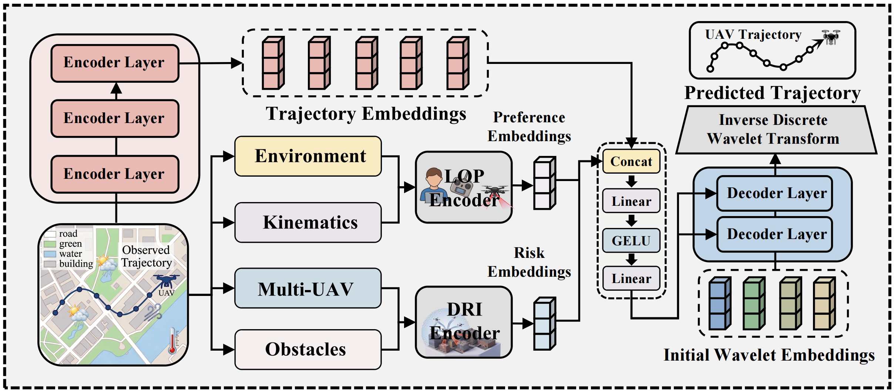

# DROP: Dynamic risk interactions and operating preferences enhance trajectory prediction for urban low-altitude aerial vehicles

# Introduction

This repository provides the source code for DROP, a Dynamic Risk-interaction and Operating-preference-enhanced Prediction framework for multi-horizon unmanned aerial vehicle (UAV) trajectory prediction. DROP builds on a direct multi-horizon time-frequency backbone that represents global trajectory trends and local motion variations in the wavelet domain. A latent operating preference (LOP) encoder characterizes context-dependent manoeuvring tendencies from observed kinematics and environmental information. A dynamic risk interaction (DRI) encoder models UAV-UAV and UAV-obstacle interactions through heterogeneous graph attention guided by physical risk descriptors. The resulting representations condition both wavelet queries and decoder memory to support trajectory prediction under complex low-altitude operating conditions.

<p align="middle"></p>

## Repository Structure

```text
DROP_CODE
|-- building_obstacle_index.py  (Load obstacle data and perform spatial queries)
|-- dataloader.py               (Load trajectories and construct environmental and interaction inputs)
|-- data_range.npy              (Provide training-set statistics for normalization and denormalization)
|-- DRI.py                      (Implement the dynamic risk interaction encoder)
|-- DROP_model.py               (Implement the DROP architecture and feature fusion)
|-- evaluate.py                 (Calculate evaluation metrics and perform formal evaluation)
|-- LOP.py                      (Implement the latent operating preference encoder)
|-- module.py                   (Provide time-frequency backbone modules)
|-- README.md                   (The current README file)
|-- test.py                     (Run automated tests)
|-- train.py                    (Prepare normalization, run diagnostics, and train the model)
|-- utils.py                    (Provide shared utilities)
|-- example_data
|   |-- README.md               (Guidance for the example data)
|   |-- dev                     (Validation samples)
|   |-- test                    (Test samples)
|   |-- train                   (Training samples)
|   `-- obstacle                (User-supplied environmental data; not included in the public release)
|-- optDir
|   `-- opt_DROP.json           (Experiment configuration)
|-- pics
|   `-- Overview.png            (Overview of the framework)
`-- pytorch_wavelets            (PyTorch wavelet-transform implementation)
```

## Package Requirements

The current implementation was tested with:

- Python 3.13.7
- PyTorch 2.8.0
- NumPy 2.3.2
- SciPy 1.16.1
- Shapely 2.1.2
- pyproj 3.7.2
- PyWavelets 1.8.0
- TensorBoard 2.20.0

# Instructions

## Create the software environment

Create an isolated Python environment and install the required packages. Select the PyTorch build that matches the local CPU or CUDA environment.

```bash
python -m pip install torch numpy scipy shapely pyproj PyWavelets tensorboard
```

## Data preparation

Processed example trajectories are provided in `example_data/train`, `example_data/dev`, and `example_data/test`. Environmental maps, buildings, obstacles, and related geographic data from the study are not publicly released because of data-security and access constraints. Users must create `example_data/obstacle`, provide environmental data matched to their own trajectories, and adjust the corresponding paths and loading definitions before running the model. Further guidance is provided in `example_data/README.md`.

When the trajectory data are replaced, regenerate `data_range.npy` using the training split only:

```bash
python train.py --config optDir/opt_DROP.json --prepare-normalization
```

Changing `data_range.npy` changes the input scale. Previously trained checkpoints must not be combined with a newly generated normalization file.

## Diagnostic checks

The model implementation, data pipeline, and automated tests can be checked before training:

```bash
python train.py --config optDir/opt_DROP.json --smoke-test
python train.py --config optDir/opt_DROP.json --smoke-data
python test.py
```

## Training

To train DROP, use:

```bash
python train.py --config optDir/opt_DROP.json
```

The main settings in `optDir/opt_DROP.json` are described below:

- `root`: path to the trajectory dataset;
- `history_length`: number of observed trajectory points;
- `prediction_length`: number of predicted trajectory points;
- `sample_dt_s`: sampling interval in seconds;
- `batch_size`: training batch size;
- `use_lop`: enable or disable the LOP encoder;
- `use_dri`: enable or disable the DRI encoder;
- `d_model`: latent feature dimension of the time-frequency backbone;
- `n_head`: number of attention heads;
- `encoder_layers`: number of Transformer encoder layers;
- `decoder_layers`: number of domain-transform decoder layers;
- `dropout`: dropout probability;
- `u2u_radius_m`: UAV-UAV retrieval radius;
- `u2o_radius_m`: UAV-obstacle retrieval radius;
- `max_u2u`: maximum number of neighboring UAVs;
- `building_k`: number of obstacle candidates;
- `lr`: initial learning rate;
- `epochs`: number of training epochs; and
- `directory`: output directory for logs and checkpoints.

The LOP and DRI pathways can be controlled independently:

| `use_lop` | `use_dri` | Model configuration |
|---:|---:|---|
| `false` | `false` | Time-frequency trajectory backbone |
| `true` | `false` | Backbone with LOP |
| `false` | `true` | Backbone with DRI |
| `true` | `true` | Full DROP model |

The configured output directory contains `Tensorboard`, `best.pt`, `last.pt`, and `train.log` after training.

## Evaluation

To evaluate a trained checkpoint, use:

```bash
python evaluate.py --checkpoint logs/DROP/best.pt --split test --output evaluation
```

Use `--split dev` for validation data and `--cpu` to force CPU execution. The evaluation directory contains `metrics.json`, `metrics.csv`, `window_manifest.json`, and `window_index.csv`.

# Dataset

The processed samples in `example_data` are provided to facilitate code validation. The example data do not constitute the complete dataset used in the study and are not intended to reproduce the reported benchmark results. The format of the trajectory files and the requirements for user-supplied environmental data are described in `example_data/README.md`.

# Contact

Hongliang Ding (mail to:hongliang.ding@swjtu.edu.cn)

Wentao Ding (mail to:wentao.ding623@gmail.com)
